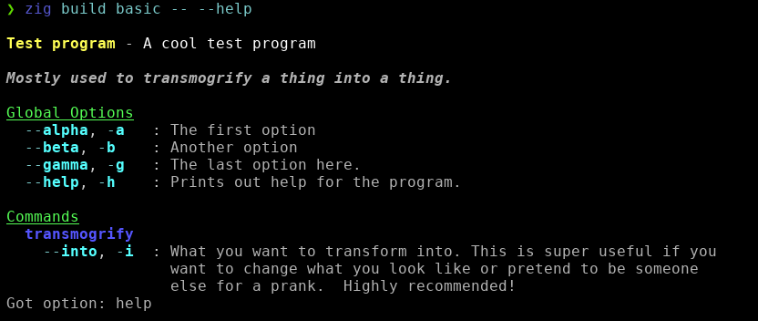

# Overview


Zargunaught is an argument parsing library for zig, based off of my earlier `argunaught` C++ library.  It features a simple API for configuring global options, commands and command specific options.

It doesn't try to map your options into a structure or use meta programming tricks to determine the types of option values.  It instead parses them into a results structure and provides helpers for getting them, leaving the semantic meaning up to the client program.

# Features

- Global options, with long and short names.
- Options can go anywhere on the command line, before or after positional arguments.
- Values attached with `--name=value` or `-nvalue`, as well as `--name value`.
- Min/max number of parameters and positional arguments.
- Support for commands with extended options per command.
- Options stacking, like `-vvv` to mark `v` as having occurred 3 times, with options for max allowed (or no stacking).
- Default values for options as either set to true, single parameter or multiple parameters.
- Ability to prepend `no-` to unset a default enabled option.
- Help text formatter with word-wrapping and basic color theming support.
- Grouping of commands for better formatted help text.
- `--` to stop option parsing and consider the rest of the command line as positional arguments.
- A lone `-` (the usual way to say stdin) and negative numbers like `-5` are positional arguments.
- `failedArg` on the parser names the argument behind a parse error.

# installing

the easiest way to use `zargunaught` in your zig program is to grab the latest tag:

```
zig fetch --save https://github.com/srjilarious/zargunaught
```

and then add it as a dependency in your `build.zig`:

```
const zargsmod = b.dependency("zargunaught", .{});
exe.root_module.addImport("zargunaught", zargsmod.module("zargunaught"));
```

# example

a simple configuration and parsing example can be seen in the `examples/basic.zig` program

here's what the help output looks like for the basic example below:



and here's the setup code in the example:

```zig
var parser = try zargs.ArgParser.init(
    std.heap.page_allocator, 
    .{
        .name = "test program",
        .description = "a cool test program",
        .usage = "mostly used to transmogrify a thing into a thing.",
        .opts = &[_]Option{
            Option{
                .longName = "alpha",
                .shortName = "a",
                .description = "the first option",
                .maxNumParams = 0,
            },
            Option{
                .longName = "beta",
                .shortName = "b",
                .description = "another option",
                .maxNumParams = 1,
            },
            Option{
                .longName = "gamma",
                .shortName = "g",
                .description = "the last option here.",
                .maxNumParams = null,
            },
        },
        .commands = &.{
            .{
                .name = "help",
                .description = "prints out this help.",
            },
            .{ .name = "transmogrify", .opts = &.{
                .{
                    .longName = "into",
                    .shortName = "i",
                    .description = "what you want to transform into. this is super useful if you want to change what you look like or pretend to be someone else for a prank.  highly recommended!",
                    .maxNumParams = 1,
                },
            },
        },
    },
});

defer parser.deinit();

var args = parser.parse(init.minimal.args) catch |err| {
    std.debug.print("error parsing args: {any} {s}\n", .{ err, parser.failedArg orelse "" });
    return;
};
defer args.deinit();
```

here you can see global options being setup, along with commands where one has a command specific option available.


# Feature Usage

## Help text
There is a built in help formatting module that can format the information in the argument parser configuration nicely and which is easy to style with different colors and such.

it also handles wrapping lines of descriptions for options and commands that get too long and properly indenting them to be more pleasing.

to display the help text, you could use the following code:

```zig
if(args.hasOption("help")) {
    var stdout = try zargs.print.Printer.stdout(std.heap.page_allocator);
    defer stdout.deinit();

    var help = try zargs.help.HelpFormatter.init(&parser, stdout, zargs.help.DefaultTheme, std.heap.page_allocator);
    defer help.deinit();

    help.printHelp(&args) catch |err| {
        std.debug.print("Err: {any}\n", .{err});
    };
}
```

`printHelp` prints the help for whatever was parsed: when a command was given, as in `prog transmogrify --help`, it prints just that command's help (`printCommandHelp`), and otherwise the full help (`printHelpText`).  You can call either of those directly too.

The full help starts with a usage line built from the configuration, like `Usage: prog [options] [command] <input> [output]`, followed by the arguments, the global options, and the commands grouped as configured.  A command's help has its own usage line (`Usage: prog [options] transmogrify [options] [thing]`), its description, its arguments, its options and the global options.

Each option that takes values shows a placeholder after its names: `<value>` when a value is required, `[value]` when it's optional, and `...` when it takes more than one.  Set `valueName` on the option to name it (`.valueName = "file"` gives `--out <file>`).  When the exact number of values isn't clear from the placeholder, or the option has a default, a note follows the description, like `(1 to 3 values)`, `(default: fast)` or `(on by default, --no-color turns it off)`.

The help goes to whichever `Printer` you give the formatter: `Printer.stdout`, `Printer.stderr`, `Printer.toFile` for any open file, or `Printer.memory` to collect it as text.  Colors are used only for a terminal that supports them.  A file printer is flushed when it's deinitialized.

The `banner` field in `ArgParserOpts` lets you override the program name shown at the top of the help output.  If not set, the `name` field is used instead.

```zig
var parser = try zargs.ArgParser.init(std.heap.page_allocator, .{
    .name = "myapp",
    .banner = "My Cool App v1.0",
    .description = "Does really cool things.",
});
```

## Min/Max Parameters and Positional Arguments

By default an option is a plain flag: `maxNumParams` is 0, so it takes no parameters.  Set `maxNumParams` to let it take values, or to `null` for no limit.  An option without a limit takes every following argument up to the next option or `--`, so it will also swallow positional arguments placed after it.

Setting `minNumParams` above `maxNumParams`, or a `default` with more values than `maxNumParams` allows, is a configuration error (`MinParamsExceedMax`, `DefaultParamsExceedMax`), which catches an option that wants values but forgot to set `maxNumParams`.

If you want the parser to throw an error depending on the number of parameters to an option:

```zig
var parser = try zargs.ArgParser.init(std.heap.page_allocator, .{ .name = "Simple options", .opts = &.{
    .{ .longName = "delta", .shortName = "d", .description = "", .minNumParams = 1, .maxNumParams = 3 },
} });
```

This would force the delta option to be provided with one to three parameters by the user.  The minimum is checked for each occurrence of the option.

Values can be given as separate arguments (`--delta a b`), or as one attached value (`--delta=a`, `-da`).  An attached value is the only value for that occurrence.  For short options, text after an option that takes parameters is its value unless it is made up entirely of other short option names, so `-vvb1` sets `v` twice and gives `b` the value `1`.  Only a short option standing alone in its argument takes values from the following arguments.

You can similarly configure the parser to expect a minimum and/or maximum number of positional arguments:

```zig
var parser = try zargs.ArgParser.init(std.heap.page_allocator, .{
    .name = "Simple options",
    .minNumPositionalArgs = 1,
    .maxNumPositionalArgs = 2,
});
```

Positional arguments can also be described by name, which puts them in the help text and its usage line:

```zig
var parser = try zargs.ArgParser.init(std.heap.page_allocator, .{
    .name = "gw-grep",
    .positionals = &.{
        .{ .name = "pattern", .description = "What to search for" },
        .{ .name = "path", .description = "Where to look", .optional = true, .repeat = true },
    },
});
```

This shows as `Usage: gw-grep <pattern> [path...]`.  Optional arguments must come after the required ones, and only the last may repeat; anything else is an `InvalidPositionals` configuration error.  When `minNumPositionalArgs` and `maxNumPositionalArgs` are left unset, they come from the list: here at least one argument, with no maximum since `path` repeats.

Commands can have their own `positionals`, `minNumPositionalArgs` and `maxNumPositionalArgs`, which replace the parser-wide ones while that command is in use.  A limit a command leaves unset falls back to the parser-wide one, and a command with no positionals of its own shows the parser-wide ones in its help.

You can also provide `defaultPositionalArgs` (`DefaultValue.param` or `.params`) to supply positional arguments when none are given by the user:

```zig
var parser = try zargs.ArgParser.init(std.heap.page_allocator, .{
    .name = "Simple options",
    .defaultPositionalArgs = zargs.DefaultValue.params(&.{ "default.txt" }),
});
```

## Default Values

The following shows the three options for default values

```zig
var parser = try zargs.ArgParser.init(std.heap.page_allocator, .{ .name = "Default options", .opts = &.{
  .{ .longName = "beta", .shortName = "b", .description = "", .default = zargs.DefaultValue.set() },
  .{ .longName = "gamma", .shortName = "g", .description = "", .default = zargs.DefaultValue.param("blah") },
  .{ .longName = "delta", .shortName = "d", .description = "", .default = zargs.DefaultValue.params(&.{ "boop", "blop", "bleep" }) },
} });
```

Here `beta` will be set, but no have any parameters associated with it.  A user could use `--no-beta` to unset it during argument parsing.  When both `--beta` and `--no-beta` are given, the last one wins.  An option whose own name starts with `no-` is matched by that name first.

An option with a default value needs `maxNumParams` at least as large as the number of default values, as `gamma` and `delta` would in practice.

The `gamma` option will by default be set with a single `blah` parameter, and `delta` will be set with the three values `boop`, `blop` and `bleep`.


## Option Stacking

Options are allowed to be set multiple times, where each time adds any new parameters to the list or parameters already seen.  For example, an `input` option could be given as `--input one --input two --input three` and the result will show a single `input` `OptionResult` with three parameters.

Each time an option is seen, the `numOccurences` attribute of `OptionResult` is incremented.  You can limit the number of occurences with the `maxOccurences` attribute when defining an option:

```zig
var parser = try zargs.ArgParser.init(std.heap.page_allocator, .{ .name = "Simple options", .opts = &.{
        .{ .longName = "verbose", .shortName = "v", .description = "log verbosity", .maxOccurences = 5 },
        .{ .longName = "delta", .shortName = "d", .description = "" },
    } });
```

## Command Groups

Command groups are useful for gathering a number of related commands together when printing out the help text.  They can be defined in the `ArgParser` initial configuration by providing a list of `GroupOpt` structs with a `name`, optional `description`, and an array of commands:

```zig
var parser = try zargs.ArgParser.init(std.heap.page_allocator, .{ 
    .name = "Simple command configuration", 
    .opts = &.{
        .{ .longName = "beta", .shortName = "b", .description = "", .maxNumParams = 1 },
        .{ .longName = "delta", .shortName = "d", .description = "", .maxNumParams = 1 },
    },
    .commands = &.{
        .{ .name = "test" },
        .{ .name = "transmogrify", .group = "experimental",
            .opts = &.{
                .{ .longName = "into", .shortName = "i", .description = "", .maxNumParams = 1 }
            }
        }
    },
    .groups = &.{
        .{
            .name = "evocation",
            .description = "Magical incantations and evocations.",
            .commands = &.{ 
                .{ .name = "fire" },
                .{ .name = "ice" },
                .{ .name = "thunder" }
            }
        }
    }
});
```

The `description` on a group is shown beneath the group name in the help output.  Commands can also be assigned to a group directly by setting the `group` field on a `CommandOpt` to the group name (as shown with `transmogrify` above); this is useful when you want to add a single command to an existing group without listing all group commands together.

## Accessing Parse Results

`ArgParserResult` provides several helpers for reading option values:

- `hasOption(name)`: returns `true` if the option was set (including via defaults)
- `option(name)`: returns a `?*OptionResult`, giving access to `values` and `numOccurences`
- `optionVal(name)`: returns `?[]const u8` for the first parameter value
- `optionValOrDefault(name, default)`: like `optionVal` but falls back to `default` if not set
- `optionNumVal(T, name)`: parses the first parameter value as any integer or float type, or returns `error.NoParamGiven` when the option has no value
- `optionNumValOrDefault(T, name, default)`: like `optionNumVal` but returns `default` if the option is absent

```zig
// Check a flag
if (args.hasOption("verbose")) { ... }

// Read a string value
const output = args.optionValOrDefault("output", "out.txt");

// Read a numeric value
const count = try args.optionNumVal(u32, "count");
const timeout = try args.optionNumValOrDefault(f32, "timeout", 30.0);
```

Positional arguments (those not associated with any option or command) are read with:

- `numPositional()`: how many there are
- `positionals()`: all of them, as a `[]const []const u8`
- `positional(idx)`: the one at `idx`, or `null`
- `positionalVal(T, idx)`: the one at `idx` parsed as a number, or `null`

## Option Placement and Commands

Options may appear anywhere: `prog file -v` and `prog -v file` mean the same thing.  `--` ends option parsing, and everything after it is positional.

The first argument that isn't an option is the command, if it names one.  Global options can be used anywhere; a command's own options are recognized after its name.  Once a positional argument has been seen, a later argument that matches a command name is just another positional argument.

Wrapper style programs, where everything from the first positional argument on belongs to something else (`prog run cmd -x`), can set `stopAtFirstPositional = true` in `ArgParserOpts` to treat the rest of the command line as positional.

## Errors

Parse errors come from `zargs.ParseError`, and configuration errors from `zargs.ParserConfigError`.  After a parse error, `parser.failedArg` holds the argument that caused it, or `null` for too few or too many positional arguments.

Parse results point into the parser (and, for `parseArray`, into the array passed in), so they must not outlive it.

# Migrating from 1.x

- `maxNumParams` now defaults to 0 instead of no limit.  Options that take values need `maxNumParams` set; use `null` for the old unlimited behavior.
- Options may now follow positional arguments.  Set `stopAtFirstPositional` to keep the old behavior.
- `positional` on the result became `positionalArgs`; read it through `positionals()` and the other helpers.
- `CommandList.find` returns `?*Command`, `ArgParser.groupData` holds `GroupData` values, `ArgParserResult.currItemPos` and `ArgParser.parseArgsForOptions` are gone.
- Duplicate command names now fail with `DuplicateCommandName`, and a command option may not reuse a global option's name.
- `OptionResult.numOccurences` is a `usize`.
- `positionalDescription` is replaced by the `positionals` list.
- `optionNumVal` returns `error.NoParamGiven` instead of `error.UnknownOption` when there's no value.
- `HelpTheme` has two new styles, `optionValue` and `positionalName`.
- `utils.tokenizeShellString` returns `ShellTokens` (use `.args`, free with `deinit(alloc)`), so it can join quoted parts like `--name="a b"` into one word; an unclosed quote is `error.UnterminatedQuote`.
